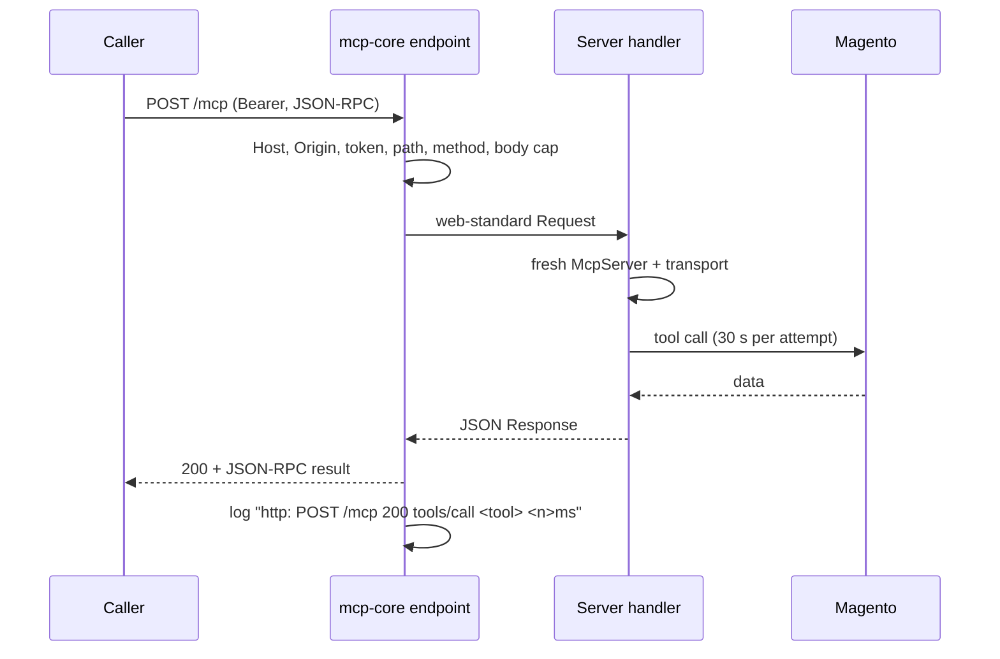

# Design: HTTP mode

```
caller ──POST /mcp──▶ mcp-core startHttpEndpoint ──Request──▶ server handler
                       Host/Origin → 403                       new WebStandardStreamableHTTPServerTransport
                       Bearer      → 401                       buildServer() from tools assembled once
                       path        → 404                       transport.handleRequest(request)
                       method      → 405 (Allow: POST)         server.close()
                       body cap    → 413
                       one access-log line on stderr
```



**H1 — Opt-in by a port variable, stdio otherwise.** A server started the way it always was is
unchanged. *Alternative rejected:* a flag; the token rule below makes the environment the one place.

**H2 — The token comes from the environment only, at least 32 characters, trimmed.** Same rule as the
credential CLI: never argv, where it reaches shell history and `ps`. Compared as SHA-256 digests with
`timingSafeEqual`, so neither its content nor its length leaks through timing. The `Bearer` scheme
name is case-insensitive (RFC 7235). Never logged, never echoed.

**H3 — Only the web-standard transport deep path.** The SDK's Node `streamableHttp.js` imports
`@hono/node-server`, which the packaging gate bans. `mcp-core` stays SDK-free: the server hands in a
`(Request) => Promise<Response>`. `node:http` is imported lazily, so stdio servers do not pay for it
at startup.

**H4 — Stateless, POST only.** No session id, JSON replies, a fresh `McpServer` and transport per
request from tools assembled once. A stateless server has no SSE stream; the MCP spec has it answer
`GET` with 405. An empty 200 (the first version) made the SDK client reconnect in a loop, building a
server on every attempt, so `GET` and `DELETE` answer 405 with `Allow: POST`.

**H5 — Screening before authentication, authentication before the body.** Host allow-list (loopback
with the bound port, plus `<PREFIX>_HTTP_ALLOWED_HOSTS`) against DNS rebinding; any `Origin` refused
unless listed (backends, not browsers); then the token; only then is the body read, capped at 1 MiB
also when chunked. Bound to `127.0.0.1` unless `<PREFIX>_HTTP_HOST` says otherwise.

**H6 — Schema adaptation across requests (`magento-graphql`, design D14).** Each request builds a new
server, so the tools the connected store lacks are kept in a process-wide set and every new server
starts with them disabled. Only the long-lived stdio server is sent `notifications/tools/list_changed`;
an HTTP caller sees the shorter list on its next `tools/list`.

**H7 — Operability.** One access-log line per request on stderr (method, path, status, JSON-RPC
method, tool name, duration; values sanitised to one bounded line). A client that leaves mid-reply
cancels the reply stream. `SIGTERM`/`SIGINT` stop accepting, give requests in flight 5 s (under
Docker's 10 s), and exit 0; the handlers are installed before the "listening" line.

**Known limits.** A caller hanging up does not cancel a tool call already under way (the SDK's
web-standard transport does not pass the request signal on); each Magento attempt still gives up
after 30 s. No concurrency cap: one authenticated caller can queue work. One store per process.
