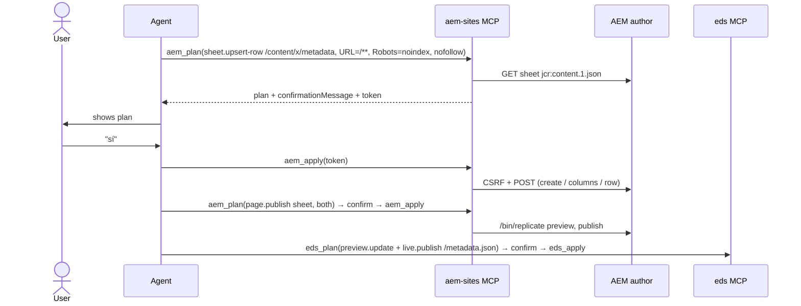

# Design: aem-sites-package

## Technical Approach

A new package built from `templates/server/`, with the same internal layering as `eds`:

```
packages/aem-sites/src/
├── client/                 # pure HTTP operations against one author; no env/credential reads
│   ├── http.ts             # fetch wrapper: Bearer header dropped on redirect, timeouts, retry (D7)
│   ├── csrf.ts             # GET /libs/granite/csrf/token.json, cached ≤ 60 s per author
│   ├── operations/
│   │   ├── pages-query.ts  # QueryBuilder (bounded predicates only)
│   │   ├── page-read.ts    # Sling GET jcr:content(.1).json, projected field by field
│   │   ├── wcm-command.ts  # createPage / copyPage / movePage / deletePage
│   │   ├── properties.ts   # Sling POST on <page>/jcr:content
│   │   ├── replicate.ts    # /bin/replicate Activate / Deactivate, agent preview|publish
│   │   └── sheet.ts        # EDS metadata / generic sheet: columns + row nodes
│   ├── planned-request.ts  # { method, path, form[] } — what the plan store keeps
│   └── index.ts            # the only import surface for code outside client/
├── guard/                  # write roots, property allowlist, suffix-operator ban (D4)
├── credential-provider.ts  # one StaticTokenProvider per env (D6)
├── tools/                  # aem_* reads, aem_plan, aem_apply
├── cli.ts / mcp.ts
```

├── confirm/                # plan store, fingerprint, protected-pattern matcher (D2)

Nothing is imported from `packages/eds`, and `packages/eds` is not modified.

## Architecture Decisions

### D1: Same plan/apply pair as `eds`, operation as a discriminated union

`aem_plan({ env, operation })` → `aem_apply({ token, env, kind, confirmTarget? })`. Reasons are
those behind `eds_plan`/`eds_apply` (one pair instead of ~20 write tools; the model cannot alter what
is applied because `aem_apply` takes only a token). The echoes `env` and `kind` exist for the
client's approval dialog, exactly as `eds_apply` echoes `site` and `kind`.

Operation kinds (Phase 1 = the immediate use case; Phase 2 = page lifecycle):

| Kind | Phase | Input | Requests built |
|---|---|---|---|
| `page.set-properties` | 1 | `path`, `set{}`, `remove[]` | 1 Sling POST on `<path>/jcr:content` |
| `page.set-robots` | 1 | `paths[]`, `robots: "noindex,nofollow" \| … \| null` | 1 Sling POST per page (`cq:robotsTags`, `@TypeHint String[]`) |
| `sheet.upsert-row` | 1 | `sheetPath`, `match{column: value}`, `values{}` | create sheet (if absent, from template) → columns → row |
| `sheet.delete-row` | 1 | `sheetPath`, `match{}` | 1 Sling POST `:operation=delete` on the row node (built by the client, never by the model) |
| `page.publish` | 1 | `paths[]`, `target: preview \| publish \| both` | 1 `/bin/replicate?cmd=Activate` per page and agent |
| `page.unpublish` | 1 | `paths[]`, `target` | `cmd=Deactivate` |
| `page.create` | 2 | `parentPath`, `name`, `title`, `template`, `properties?` | `wcmcommand createPage` (+ properties POST) |
| `page.copy` | 2 | `srcPath`, `destParentPath`, `name?`, `deep` | `wcmcommand copyPage` |
| `page.move` | 2 | `srcPath`, `destParentPath`, `destName?` | `wcmcommand movePage` (`integrity=true`; reference adjustment not offered, see Implementation notes) |
| `page.delete` | 2 | `path` | `wcmcommand deletePage`, **refused at plan time if the page or a child is published** |

`paths[]` is bounded to 100, like `plannedPaths` in `eds`.

**"Block indexing" therefore has two first-class routes**, and the plan states which one it uses:

1. per page → `page.set-robots` (page properties, travels with the page; *unverified* until the
   XWalk rendering of `cq:robotsTags` is confirmed in Phase 6);
2. site-wide or by URL pattern → `sheet.upsert-row` on the EDS bulk `metadata` sheet
   (`URL=/**`, `Robots=noindex, nofollow`) — the route the field CLI proved. Publishing the sheet
   is a separate `page.publish` plan, and refreshing `/metadata.json` in EDS is an `eds_plan`
   (`preview.update` + `live.publish`) on the other server.

**"Block publication"** is `page.unpublish` (Deactivate) for what is already out, plus the
protected-path mechanism (D5) for what must never be published through the agent. A persistent
"do not publish" flag honoured by AEM itself (a replication preprocessor or workflow) is **not**
built: decided 2026-10-27, blocking through the MCP is enough (see Open Questions, Resolved).

### D2: Own confirmation machinery in `packages/aem-sites/src/confirm/`

The package carries its own plan store (in-memory, TTL 10 min, one-time tokens bound to env, kind
and the stored requests), `fingerprint` (sha256 of canonical JSON) and anchored `*` pattern
matcher for protected paths. It follows the same pattern as the `eds` server so a user sees one
behaviour, but it does **not** import from `eds` and does not wait for any `eds` change: the two
servers are independent packages. If a third package ever needs the same store, promoting it to
`mcp-core` is a later, separate decision.

### D3: Classic author endpoints, one operation = one endpoint

| Operation | Endpoint | Field-proven |
|---|---|---|
| list pages | `GET /bin/querybuilder.json?path=…&type=cq:Page&p.limit=…&p.offset=…` | yes |
| read page | `GET <page>/jcr:content.1.json` (+ `.json` on the page node) | yes |
| CSRF | `GET /libs/granite/csrf/token.json` | yes |
| properties / sheet rows | `POST <node>` (Sling POST servlet, form-encoded) | yes |
| create sheet | `POST /bin/wcmcommand cmd=createPage template=<sheet template>` | yes |
| create/copy/move/delete page | `POST /bin/wcmcommand cmd=…Page` | createPage yes; others **unverified** |
| publish / unpublish | `POST /bin/replicate cmd=Activate\|Deactivate path=… [type=preview]` | Activate yes; Deactivate **unverified** |
| auth probe | `GET /bin/querybuilder.json?…&p.limit=1` (same probe as the field CLI) | yes |

QueryBuilder is never exposed raw: the client builds predicates from `{ root, depth?, template?,
modifiedSince?, limit, offset }`. Every response is projected through a named field allowlist
(repo rule), so a node property the author adds never reaches the model.

### D4: The write guard — the unsafe request cannot be built

The Sling POST servlet writes whatever it is told. The guard runs **in the client, when a request
is built**, so neither plan nor apply can produce a request that fails it:

1. **Write roots.** `AEM_WRITE_ROOTS` (required for any plan; comma-separated, each starting with
   `/content/`). Every target path, after normalisation (no `..`, `//`, `.`, trailing selectors or
   extensions), MUST be equal to or under a root. `/apps`, `/libs`, `/conf`, `/home`, `/var`,
   `/etc`, `/content/dam` are rejected even if listed — a registration-time error, like
   `magento-cloud`'s forbidden commands.
2. **Property allowlist.** `page.set-properties` accepts only names in a closed list
   (`jcr:title`, `jcr:description`, `pageTitle`, `navTitle`, `hideInNav`, `cq:robotsTags`,
   `cq:tags`, `cq:canonicalUrl`, `sling:alias`, `cq:redirectTarget`) plus names matching
   `AEM_EXTRA_PROPERTIES` (exact names, no wildcard) for project-specific metadata.
   Never: `jcr:primaryType`, `jcr:mixinTypes`, `sling:resourceType`, `cq:template`, `rep:*`,
   `cq:lastReplicat*`, `jcr:created*`, `cq:lastModified*`.
3. **No model-controlled operators.** A name or value key containing `@` or starting with `:` is
   rejected. `@TypeHint`, `@Delete` and `:operation=delete` exist only as constants emitted by
   the client for the kinds that need them.
4. **Sheet rows** accept only columns already in the sheet or added by the same plan; column and
   row node names are generated by the client (`row`, `row0`, …), never taken from input.

### D5: Environments, protected environments and protected paths

- `AEM_AUTHORS="stage=https://author-p<program>-e<env>.adobeaemcloud.<tld>,prod=https://…"` — named
  environments. Each URL MUST fullmatch `https://author-p\d+-e\d+\.adobeaemcloud\.com` (the field
  CLI's rule); anything else fails at startup. Every tool takes `env`.
- `AEM_PROTECTED_ENVS` (env names) and `AEM_PROTECTED_PATHS` (anchored `*` patterns, e.g.
  `/content/*/en`): a plan touching either sets `requiresConfirmTarget`; `aem_apply` must echo the
  env name (protected env) or the matching protected pattern(s) (protected path) in `confirmTarget`.
- `page.publish` on a protected path is refused outright unless `AEM_ALLOW_PROTECTED_PUBLISH=1`
  — this is the "block publication through the agent" switch.

### D6: Credentials — one bearer token per environment (as the field CLI)

Authentication is **token only**, mirroring `eds aem auth` in the project's field CLI: the
Developer Console *local development token* of each author, sent as `Authorization: Bearer`.
No service credentials, no JWT signing, no IMS exchange, no refresh.

| Step | Field CLI (`eds aem auth …`) | This package |
|---|---|---|
| Where it lives | `EDS_AEM_TOKEN_<ENV>` → macOS keychain → `~/.eds-secrets.json` | `AEM_TOKEN_<ENV>` → `$XDG_CONFIG_HOME/hiberus/aem-sites-<env>.json` (0600), resolved by `mcp-core`'s `resolveCredentialValue` with domain `aem-sites-<env>` |
| How it is stored | `eds aem auth token set --env E` (stdin, file or hidden prompt) | `hiberus-aem-sites auth token set --env E`, **stdin only** (repo rule: no token in argv); `mcp-core` refuses a file that is not 0600 |
| Input accepted | raw token, the Developer Console JSON (`accessToken`), `Bearer ` prefix stripped | same |
| Check | `eds aem auth status`: QueryBuilder probe, `200` OK / `401` expired / `403` no rights / non-JSON = redirected to login | `aem_check_auth` and `auth status` run the same probe (`p.limit=1` under the first write root) |
| Clear | `eds aem auth token clear [--env]` | `hiberus-aem-sites auth token clear --env E` |
| Sent to | only the author host, header not forwarded on redirect | same (`redirect: "manual"`) |

Decisions inside D6:

- **Env names** come from `AEM_AUTHORS` and MUST match `[a-z0-9]+`, so `AEM_TOKEN_<ENV>` is
  always a valid variable name (`stage` → `AEM_TOKEN_STAGE`).
- **No keychain.** The field CLI's keychain support shells out to `security`; here that would
  need a new entry in `mcp-core`'s exec allowlist for one OS. The 0600 file plus the env var is
  what every other server in the repo uses. It can be added later as its own change.
- **Expiry is surfaced, not handled.** The token lasts 24 h. A `401`, or a 3xx/HTML login page,
  becomes `AemAuthError { env, remedy: "hiberus-aem-sites auth token set --env <env>" }`; the
  plan store is unaffected, so the user renews the token and re-runs `aem_apply` with the same
  token if it has not expired, or re-plans.
- **`StaticTokenProvider` from `mcp-core`** is reused per env (one instance per configured env,
  built in `credential-provider.ts`, as `eds` does). The client never reads env vars or files.
- Whether the token is read once at startup or on each call: **on each call** (as
  `StaticTokenProvider` already does), so renewing it does not require restarting the MCP client.

### D7: Retry policy from field findings

| Observation (field CLI) | Policy |
|---|---|
| `409` on columns/row right after creating a sheet page (19 of 32 sites) | retry 1 s, 2 s, 4 s on `409` for POSTs inside the same plan |
| `400` on `Activate` to `publish` right after `preview` | 1 s pause between agents; one retry after 3 s on `400` |
| `401` | no retry; named error with remedy (token expired) |
| `429` / `5xx` | exponential backoff, max 3, honour `Retry-After` |

Retries never re-plan: the request bytes are identical.

### D8: Fingerprint and what `aem_plan` returns

The fingerprint covers what the user reviewed: for property and sheet kinds, the projected
`jcr:content` (+ sheet rows) and `cq:lastModified`; for publish kinds, `cq:lastModified` of each
page (so a page edited after the plan is not published unseen); for lifecycle kinds, existence of
source and absence of destination. `aem_apply` re-reads and rejects on mismatch with `stale-plan`.

`aem_plan` returns `{ status, token, expiresAt, env, kind, summary, changes[] (before/after per
property or row), requests[] (method + path only), warnings[], confirmationMessage, instruction,
requiresConfirmTarget }` — the `eds` shape, so a skill composing both servers handles one format.
Mandatory warnings: publish to `publish` "also publishes to EDS live for an EDS-connected site";
unpublish "removes the page from EDS live"; `page.set-robots` while unverified.

## Data Flow — site-wide noindex on an EDS site sourced from AEM



## Testing Strategy

Strict TDD, `fetch` double (as in `eds`), synthetic identifiers only. Property-based tests for the
guard (random paths with `..`, encoded slashes, selectors; random property names with `@`/`:`).
Conformance suite and packaging gate unchanged. Token tests (missing/forged/expired/reused/stale)
for every kind. Live validation is Phase 6, against a non-production author, results recorded in
`verify-report.md`.

## Threat Matrix

| Threat | Control |
|---|---|
| Model writes outside the site tree | D4.1 write roots, normalisation before matching |
| Model changes a node type / template / ACL via properties | D4.2 allowlist, D4.3 operator ban |
| Model applies something different from what was shown | token + stored requests, replay verbatim |
| Content changed by an editor between plan and apply | fingerprint (D8) |
| Token leaked into transcript | never echoed; redaction of tool output via `mcp-core` |
| Credential sent to a host the model chose | hosts fixed at startup from env, regex-validated |

## Deferred

- `package.upload-install` (Package Manager): needs filter validation (only write roots, no
  `/apps`), behind `AEM_ENABLE_PACKAGES=1`; own change.
- `page.import-content` (Sling `:operation=import` of a JSON component tree) with a
  `sling:resourceType` allowlist; own change.
- Publish with children (tree activation), scheduled publication, MSM rollout.

## Implementation notes (2026-10-28)

Decisions taken while implementing, recorded so they are not silent deviations:

- **Manifest domain is `aem`**, not `aem-sites`: the repository derives a server's environment-variable
  prefix from its `domain` (`scripts/manifest-env.mjs`), and the variables designed here are `AEM_*`.
  Package name, bins and credential files keep `aem-sites`.
- **`AEM_TOKEN_<ENV>` is not in `servers.json`'s `requires.env`**: the schema only accepts literal
  names. It is documented inside `AEM_AUTHORS`'s description and in the onboarding doc.
- **Reads are limited to `/content/` (never `/content/dam`)** even though they are not limited to the
  write roots: a QueryBuilder read under `/home` or `/apps` would leak users or code.
- **The protected-path confirmation is the matching pattern**, not each path, so a plan over many
  pages under one protected tree needs one typed value. `page.unpublish` on a protected path is
  allowed behind it — unpublishing is how publication is blocked.
- **`page.move` does not adjust references** (`adjust` parameters of `movePage` are not field-proven);
  it sends `integrity=true`. Revisit after Phase 6.
- **`page.unpublish` skips pages not activated on that agent**, and returns `no-changes` if none is.
- **Preview replication state is not recorded by AEM** (observed on the pre author, 2026-10-28: a
  sheet activated to preview and publish carries `cq:lastReplication*` and `*_publish`, nothing for
  preview). Publish state is read from `*_publish` falling back to the plain names; preview is reported
  as `not-recorded-by-aem`, `page.unpublish` from preview is always sent, and `page.delete` can only
  check the publish agent (it warns about preview).
- **Per-page robots is the `robots` text field of the XWalk `page-metadata` model** (declared in the
  storefront's `component-models.json` and in the page's `modelFields` on the author), not
  `cq:robotsTags`. `page.set-robots` writes `robots = "noindex, nofollow"`; `robots` and `keywords`
  join the built-in property allowlist. That EDS renders it is still to be checked on a live page.
- **A failure mid-apply is reported, not rolled back**: `aem_apply` returns `failed` with the
  requests that succeeded and how many were not sent.
- **The CLI's `plan`/`apply` run plan and apply in one process** (the plan store is in memory);
  `apply` without `--yes` only prints the plan.
- **Shared fixtures**: `SYNTHETIC_AEM_AUTHOR(_2)` and `SYNTHETIC_AEM_CONTENT_ROOT` added to
  `mcp-testing`, and the audit script accepts exactly the all-zero synthetic AEM hosts plus the bare
  `adobeaemcloud.com`.

## Open Questions

1. Does EDS render the page-metadata `robots` field as `<meta name="robots">` once published?
   (`cq:robotsTags` is not the field XWalk uses — see Implementation notes.)
2. Max pages per `aem_apply`: 100 (as `eds`) or lower given one request per page and agent?

### Resolved

- **2026-10-27 — Blocking publication.** Done only through this MCP: `AEM_PROTECTED_PATHS` +
  `AEM_ALLOW_PROTECTED_PUBLISH` (D5) to keep the agent from publishing, and `page.unpublish` to
  take down what is already out. No author code (replication preprocessor, workflow) and no
  "never publish" flag honoured by the Sites console. Editors publishing from the console are
  not restricted by design.
- **2026-10-27 — Authentication.** Bearer token per environment only, as the field CLI does
  (D6). Service credentials / OAuth server-to-server are out of scope.
